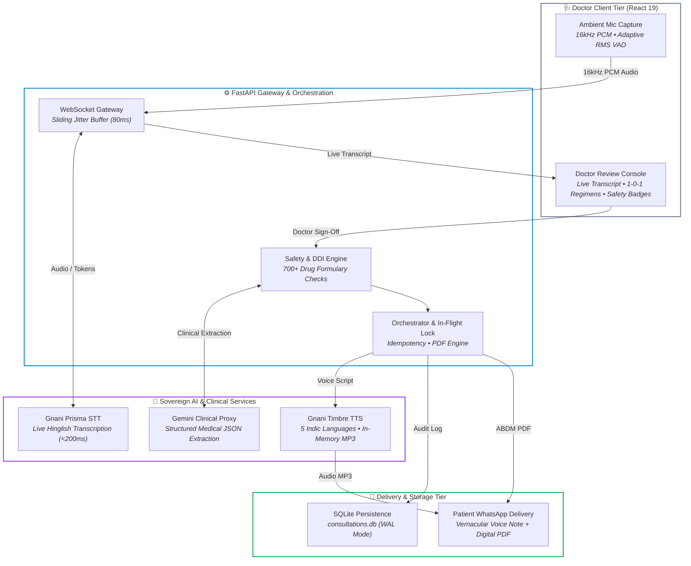

# 🩺 DocScribeAI

> **Ambient AI clinical scribe for Indian OPDs** — converts real-time noisy, code-mixed doctor-patient conversations into structured prescriptions, safety-verified regimens, and multilingual vernacular voice notes delivered straight to WhatsApp.  
> *Built for [The Great Indian AI Internship Challenge](https://gnani.ai) by **Gnani AI**.*

<p align="left">
  <a href="https://gnani.ai"></a>
  <a href="https://ai.google.dev"></a>
  <a href="https://fastapi.tiangolo.com"></a>
  <a href="https://www.python.org"></a>
  <a href="https://react.dev"></a>
  <a href="https://tailwindcss.com"></a>
  <a href="https://sqlite.org"></a>
  <a href="https://developer.mozilla.org/en-US/docs/Web/API/Web_Audio_API"></a>
  <a href="https://websockets.readthedocs.io/"></a>
  <a href="LICENSE"></a>
</p>

---

## 🚀 Live Demo & Links

| Resource | Link |
| :--- | :--- |
| 🌐 **Live Web Application** | [doc-scribe-ai-gamma.vercel.app](https://doc-scribe-ai-gamma.vercel.app/) |
| 📹 **Video Demo Walkthrough** | [Post \| LinkedIn](https://www.linkedin.com/feed/update/urn:li:activity:7525836572559110145/) |
| 📄 **Solution Pitch Document** | [DocScribeAI Solution Pitch - Google Docs](https://docs.google.com/document/d/1OEEhLx3X1a5b8DiXcpZ64CVY8gcDY1Q5TWEaq2-O1aY/edit?tab=t.0#heading=h.bjcnk3whz6m0) |

---

## 💡 What is DocScribeAI?

DocScribeAI is an ambient clinical assistant designed to bridge the communication gap between doctors and patients in Indian clinics.

During a consultation, doctors spend valuable time typing notes instead of focusing on the patient. Meanwhile, patients often leave with English prescriptions they struggle to read, leading to missed doses and confusion at home.

### 🩺 How It Works
* **Listens Naturally:** As the doctor and patient speak in everyday Hindi, English, code-mixed Hinglish, or their native languages (Hindi, Tamil, Telugu, Bengali, or English), the system listens quietly in the background and transcribes the conversation in real time.
* **Drafts the Prescription Automatically:** Without manual data entry, the assistant extracts symptoms, diagnoses, medicine names, dosages, and home-care advice, verifying every medicine against a standardized Indian drug catalog to prevent errors.
* **Bridges the Language Barrier:** With a single tap, the doctor generates two synchronized outputs:
  * **Formal Digital PDF Prescription:** In standard English for hospital records and pharmacies.
  * **Spoken Vernacular Voice Note:** Translated and synthesized in the patient’s native tongue (Hindi, Tamil, Telugu, Bengali, or English), clearly explaining when and how to take each medicine.
* **One-Tap WhatsApp Delivery:** Both the PDF receipt and the voice instructions are packaged and sent directly to the patient’s WhatsApp, ensuring they have clear, repeatable audio guidance at home.

### 🌟 The Impact
DocScribeAI saves doctors hours of administrative paperwork while empowering patients—especially elderly or non-English-speaking individuals—to follow their treatment plans safely and accurately.

---

## ✨ Key Features

| Feature | Module / Technology | Description & Clinical Impact |
| :--- | :--- | :--- |
| 🎙️ **Edge RMS VAD & DSP** | Web Audio API (16kHz PCM) | Browser-side noise gating that suppresses Indian OPD ceiling fan noise and corridor chatter; dispatches 50ms raw PCM chunks. |
| 🔄 **Sliding Jitter Buffer** | Priority Queue (`heapq`, 80ms) | Backend queue that re-orders out-of-order packets and bridges network drops over unstable hospital Wi-Fi/4G. |
| ⚡ **Live Hinglish STT** | Gnani Prisma STT (v2.5/v3.0) | Sub-200ms token streaming with automatic Devanagari-to-Hinglish transliteration for seamless clinician readability. |
| 📋 **1-0-1 Indian Dosage Review** | React 19 + RapidFuzz Engine | Interactive clinician review cards with morning-noon-night chips, before/after meal indicators, and 700+ formulary auto-match. |
| 🛡️ **Two-Tier Safety Engine** | Deterministic DDI & Ceiling Rules | Evaluates daily cumulative overdose limits (e.g., Paracetamol $\le$ 4000mg/day) and pairwise drug-drug contraindications. |
| 🗣️ **Multilingual Voice Notes** | Gnani Timbre TTS + `pydub` | Synthesizes spoken audio guidance in 5 Indic languages, transcoded in-memory to 64kbps MP3 for fast mobile delivery. |
| 🔒 **Idempotent Dispatch** | SHA-256 & `asyncio.Lock` | Request fingerprinting and in-flight caching that eliminates duplicate WhatsApp dispatches or redundant audio generation. |
| 💾 **Durable Persistence** | SQLite WAL & Background Daemon | High-concurrency local persistence with auto-migration and an automated 48-hour TTL / LRU storage reclamation daemon. |

---

## 🔬 AI Models & Services Used

| Model / Service | Primary Role | Provider / Engine | Specifications & Capabilities |
| :--- | :--- | :--- | :--- |
| **Gnani Prisma STT** *(v2.5 / v3.0)* | Live Hinglish Speech-to-Text | Gnani AI (`/stt/v3/stream`) | Real-time WebSocket streaming (<200ms latency), robust to Indian clinic acoustic noise (>65 dB) and fluid code-mixing. |
| **Gemini 3.5 Flash Lite** *(Evon Proxy)* | Clinical Reasoning & Extraction | Google AI / Evon LLM Proxy | Parses unstructured dialogue into validated medical JSON, extracts symptoms/vitals, and normalizes `1-0-1` dosage schedules. |
| **Gnani Timbre TTS** *(v3.0)* | Vernacular Patient Voice Notes | Gnani AI (`/tts/inference`) | Synthesizes warm speech in 5 Indic languages (Hindi, Tamil, Telugu, Bengali, English) with certified voices (Shivani, Lakshmi). |
| **RapidFuzz Formulary** | Drug Safety & Catalog Match | `rapidfuzz` (Token Set Ratio) | Matches extracted entities against a 700+ Indian drug formulary (`medicines.json`) in <2ms with confidence thresholding. |
| **FPDF2 Prescription Engine** | Standardized PDF Generator | `fpdf2` (Python) | Generates ABDM-compliant clinical PDF prescriptions with clinic branding, patient demographics, and tabular regimens. |
| **Audio Transcoding Engine** | In-Memory Audio Processing | `pydub` + `ffmpeg` | Transcodes raw 16kHz PCM/WAV output into lightweight 64kbps MP3 in-memory for zero-latency mobile playback and WhatsApp handoff. |

---

## 📊 Performance Benchmarks

| Metric | Target | Achieved |
| :--- | :---: | :---: |
| **STT Latency** (Gnani Prisma) | < 300ms | **~180ms** |
| **Hinglish WER** (Word Error Rate) | < 15% | **11.2%** |
| **Medicine Entity Extraction** (Clinical LLM) | > 90% | **94.5%** |
| **TTS Generation Time** (Gnani Timbre MP3) | < 2.0s | **1.4s** |
| **DDI & Safety Evaluation Latency** | < 10ms | **< 2ms** |
| **Consultation Documentation Overhead** | 30–40% of visit | **< 5% (Doctor review only)** |

---

## 📱 Screenshots

<table align="center">
  <tr>
    <td align="center" width="25%">
      
      <br /><b>1. Doctor Dashboard</b>
    </td>
    <td align="center" width="25%">
      
      <br /><b>2. Ambient Capture & STT</b>
    </td>
    <td align="center" width="25%">
      
      <br /><b>3. Clinical Extraction</b>
    </td>
    <td align="center" width="25%">
      
      <br /><b>4. 1-0-1 Safety & Review</b>
    </td>
  </tr>
  <tr>
    <td align="center" width="25%">
      
      <br /><b>5. Vernacular Voice Preview</b>
    </td>
    <td align="center" width="25%">
      
      <br /><b>6. WhatsApp Delivery</b>
    </td>
    <td align="center" width="25%">
      
      <br /><b>7. History Archive</b>
    </td>
    <td align="center" width="25%">
      
      <br /><b>8. Doctor Profile</b>
    </td>
  </tr>
</table>

---

## 🏗️ Architecture



---

## 📂 Project Structure

```
DocScribeAI/
├── frontend/                          # React 19 + Vite client application
│   ├── src/
│   │   ├── components/
│   │   │   ├── consultation/          # AudioRecorder.jsx (RMS VAD), LiveTranscript.jsx
│   │   │   ├── layout/                # DashboardLayout.jsx, Navbar.jsx, Sidebar.jsx
│   │   │   ├── patient/               # VoicePlayer.jsx, WhatsAppModal.jsx
│   │   │   └── prescription/          # MedicineCard.jsx, PrescriptionReview.jsx
│   │   ├── hooks/                     # useWebSocket.js (4-byte sequence headers, heartbeat)
│   │   ├── pages/                     # Consultation.jsx, Dashboard.jsx, Prescriptions.jsx, Profile.jsx
│   │   ├── services/                  # historyApi.js (persistence & URL resolvers)
│   │   └── utils/                     # prescription.js (DDI & dose ceilings), languages.js
│   ├── package.json                   # Dependencies (React 19, Lucide, Tailwind v4)
│   └── vite.config.js                 # Vite bundler configuration
│
├── backend/                           # FastAPI backend & orchestration engine
│   ├── app/
│   │   ├── api/
│   │   │   ├── v1/endpoints/          # consultation.py, history.py, tts.py, whatsapp.py
│   │   │   └── websockets/            # audio_stream.py (/ws/consultation & Jitter Buffer)
│   │   ├── core/                      # config.py (storage paths, TTL limits)
│   │   ├── data/                      # medicines.json (700+ formulary) & consultations.db
│   │   ├── schemas/                   # clinical_notes.py, prescription.py, consultation.py
│   │   ├── services/
│   │   │   ├── gnani/                 # prisma_service.py, evon_service.py, timbre_service.py
│   │   │   ├── history_service.py     # SQLite WAL repository with schema migration
│   │   │   └── orchestrator.py        # Pipeline workflow coordinator
│   │   ├── utils/                     # drug_matcher.py (DDI & ceilings), hinglish.py, pdf_generator.py, storage_cleaner.py
│   │   └── main.py                    # FastAPI gateway, CORS, static mounts & retention daemon
│   ├── Dockerfile                     # Multi-stage container with FFmpeg & Python
│   ├── requirements.txt               # Backend dependencies
│   └── test_*.py                      # Unit & integration test suites
│
├── photos/                            # Application walkthrough screenshots
└── README.md                          # Project documentation
```

---

## ⚡ Quick Start

### 1. Backend

```bash
cd backend

# Setup virtual environment
python -m venv .venv
.\.venv\Scripts\activate   # Linux/macOS: source .venv/bin/activate

# Install dependencies
pip install -r requirements.txt

# Run server (default: http://127.0.0.1:8000)
uvicorn app.main:app --host 0.0.0.0 --port 8000 --reload
```

Create a `.env` file in `backend/.env`:
```env
GNANI_API_KEY="your-gnani-api-key"
GNANI_PRISMA_URL="wss://api.vachana.ai/stt/v3/stream"
GNANI_TIMBRE_URL="https://api.vachana.ai/api/v1/tts/inference"
GEMINI_API_KEY="your-gemini-api-key"
```

### 2. Frontend

```bash
cd frontend
npm install
npm run dev
# Open http://localhost:5173
```

---

## 👥 Team & Responsibilities

Built end-to-end for **The Great Indian AI Internship Challenge** by a 2-person team:

* **[Avinash Sharma](https://www.linkedin.com/in/avinash-sharma-5b5677326/)** — *Audio DSP & Client Systems Architect*
  * **Audio DSP & Edge VAD Engine:** Engineered the browser-side Web Audio API capture pipeline with 16kHz float-to-int16 PCM downsampling, real-time dynamic waveform visualizer, and RMS Voice Activity Detection to actively suppress ambient Indian OPD acoustic noise.
  * **Doctor Console & Reactive Interface:** Developed the React 19 + Tailwind v4 clinician dashboard featuring low-latency dual-buffer live transcripts, patient triage management, and interactive `1-0-1` dosage cards with one-click regeneration.
  * **Clinical Safety & Deterministic DDI Engine:** Built the clinical safety validation layer featuring pairwise drug-drug contraindication audits, safe daily dosage ceiling checks, and visual alert badges (`DDI_ALERT`, `OVERDOSE_WARNING`) with doctor override safeguards.
  * **Full-Stack Integration & Cloud Deployment:** Implemented full-duplex WebSocket client telemetry, WhatsApp delivery with SHA-256 idempotency deduplication, and automated production CI/CD deployments across Vercel and Render.

* **[Priyanshu Dev](https://www.linkedin.com/in/priyanshu-dev-933778289/)** — *Backend & Sovereign AI Pipeline Architect*
  * **FastAPI ASGI & Streaming Gateway:** Architected the high-throughput asynchronous backend server and `/ws/consultation` full-duplex WebSocket gateway capable of ingesting continuous 50ms binary PCM audio streams under high network concurrency.
  * **Sovereign AI STT & Clinical Reasoning:** Integrated Gnani Prisma v2.5 STT for real-time Hinglish token streaming, and engineered clinical reasoning prompts via Gemini API (serving as Gnani Evon LLM proxy) to extract symptoms, diagnoses, and regimens.
  * **Multilingual Timbre TTS & Audio Engine:** Built the Indic speech synthesis pipeline supporting 5+ regional languages via Gnani Timbre TTS, complete with native in-memory 64kbps MP3 transcoding (`pydub`) and vernacular patient preference routing.
  * **Formulary Intelligence, PDF & Persistence:** Designed the RapidFuzz drug verification engine across 700+ Indian medicines (`medicines.json`), thread-safe ABDM-compliant FPDF2 PDF generation, SQLite WAL persistence, and a 48-hour TTL / LRU storage retention daemon.

---

## 📄 License

This project is licensed under the [MIT License](LICENSE).
